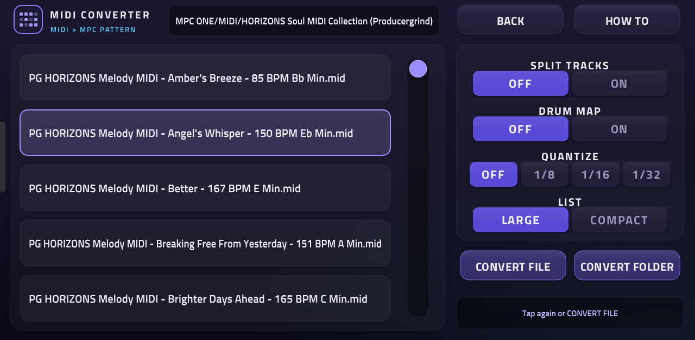

# MPC MIDI Converter

A free, open-source tool that turns MIDI files (`.mid`, `.midi`) into MPC pattern files (`.mpcpattern`), right on the MPC.
Load a pattern onto any track and the notes land in that track, at your project's tempo, without MPC's MIDI import making a new
sequence.



**[Download the latest release](https://github.com/3dthc/MPC-MIDI-Converter/releases/latest)** (`MPC-MIDI-Converter-<version>-mpc-armv7.zip`)

## Features

- Browse your SD card, internal drive and USB drives right on the MPC's touchscreen
- Convert one file, or a whole pack with all the folders inside it, keeping the pack's folder structure
- Patterns land in a **MIDI Converts** folder on the same drive, with the tempo in each name
- Split multi-track files into one pattern per instrument
- Map General MIDI drums onto MPC pads
- Quantize to 1/8, 1/16 or 1/32
- Large, readable text with a compact list option, and a built-in How To page
- Damaged or hostile MIDI files are refused safely instead of crashing MPC

## Install

Works on Gen 1 MPCs and the Force (MPC Live, Live II, One, X, Key 61) with MPC OS 3.x.

- **MPC OS 3.10.1 and later:** turn on *Preferences > Enhancements > External Plugin Support*, unzip the release and copy
  the `3dthc - VST - MPC MIDI Converter` folder into a `VST2 Plugins` folder at the top of any drive.
- **Or** use the [Open MPC Plugin Manager](https://open-mpc.github.io/install.html) or installer app, or the `install.sh` in
  the zip (its `INSTALL.md` has every route).

Windows (`.exe`) and Mac (`.dmg`) versions are planned.

## Using it

1. Add **MPC MIDI Converter** to a track (it is listed with the instruments).
2. Tap a drive, then tap folders to open them. **BACK** goes up a folder; drag the scroll bar beside the list to scroll.
3. Tap a MIDI file to pick it (it lights up), then tap it again or tap **CONVERT FILE**. **CONVERT FOLDER** converts
   every MIDI file in the folder you are in, and in its subfolders.
4. Find the patterns in the **MIDI Converts** folder at the top level of the drive your MIDI files are on (the status
   line says where). Load one onto a track from MPC's browser.

**HOW TO** shows these steps on the plugin's page.

## Options

| Option | What it does |
|---|---|
| **Split tracks** | **Off** puts the whole file in one pattern. **On** makes one pattern per MIDI track (per channel, for single-track files), named after the track. |
| **Drum map** | **On** moves General MIDI drum notes onto MPC pads (layout below), for drum loops made in other software. |
| **Quantize** | Snaps note starts to 1/8, 1/16 or 1/32. |
| **List** | **Large** shows 5 big rows; **Compact** shows 8. |

Patterns do not store tempo, so the file's tempo is added to the pattern's name, for example `Groove 01 (92 BPM).mpcpattern`.
A folder conversion keeps the pack's own folder structure inside MIDI Converts.

### Drum map (GM to Pads)

| Pad | Sound | Pad | Sound |
|---|---|---|---|
| A01 | Kick | A09 | High tom |
| A02 | Snare | A10 | Crash, splash, china |
| A03 | Closed hat | A11 | Ride, ride bell |
| A04 | Open hat | A12 | Pedal hat |
| A05 | Clap | A13 | Tambourine |
| A06 | Side stick, rim | A14 | Shaker, cabasa, maracas |
| A07 | Low tom | A15 | Cowbell |
| A08 | Mid tom | A16 | Any other percussion |

## Building

Needs Docker and [Open MPC](https://github.com/open-mpc/mpc-vst-plugins) checked out next to this folder.

```sh
./build.sh                      # tests, then builds vst/build/<.so> and the skin
test/run_tests.sh               # just the tests (converter, damaged and crafted files, the plugin's browser), no Docker
./release.sh 1.0.1              # checks the toolchain is current, builds, packages and catalog-checks the zip
./release.sh 1.0.1 --publish    # the same, then creates or updates GitHub release v1.0.1 (notes: release-notes/1.0.1.md)
```

`release.sh` stops if `mpc-vst-plugins` is behind Open MPC, if `vst/vst.json` has another version, or if the catalog
check finds anything to fix, so every release zip works on current MPC OS versions.

## Licence

MIT. If this tool helps you, you can support it at [ko-fi.com/3dthc](https://ko-fi.com/3dthc).
